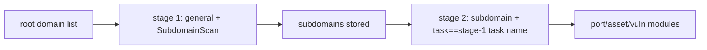

---

## name: scopesentry-mcp
description: Manage a security scanning platform (projects, tasks, templates, assets, nodes) through the ScopeSentry MCP. Use when the user mentions ScopeSentry, MCP, API Key, scan tasks, or asset queries.

# ScopeSentry MCP Usage Guide

For users with an **already-deployed ScopeSentry instance**. Connect to the platform through Cursor (or another MCP client); no local source code is needed.

## 1. Preparation

### 1.1 Confirm the service is reachable

- Default web UI: `http://<host>`
- MCP endpoint: `http://<host>/mcp` (if there is a reverse proxy or frontend proxy in front, use the actual `/mcp` address)

### 1.2 Create an API Key

1. Log in to the ScopeSentry web UI in a browser
2. Go to the **API Key** management page and create a key (or create one via an interface provided by the administrator)
3. Save the returned `ssk_...` string (**shown only once**)

### 1.3 Configure Cursor MCP

Cursor → Settings → MCP → Add server:

```json
{
  "mcpServers": {
    "scopesentry": {
      "url": "http://<your-host>:8082/mcp",
      "headers": {
        "X-API-Key": "ssk_your-key"
      }
    }
  }
}
```

You can also use: `Authorization: Bearer ssk_your-key`

After configuring, restart the MCP or reload Cursor, and confirm that `list_projects`, `list_assets`, etc. appear in the tool list.

---

## 2. Tool Overview


| Tool                     | Purpose             |
| ---------------------- | ----------------- |
| `list_projects`        | Project tree grouped by tags (includes project IDs) |
| `list_projects_data`   | Paginated project list, searchable by name |
| `get_project`          | Project details     |
| `create_project`       | Create a project    |
| `list_tasks`           | Scan-task list      |
| `get_task`             | Task details        |
| `list_scan_templates`  | Scan-template list  |
| `get_scan_template`    | Template details    |
| `list_plugin_modules`  | Scan-pipeline module names |
| `list_plugins`         | Available plugins (with hash, default parameters) |
| `create_scan_template` | Create a scan template |
| `create_scan_task`     | Create a scan task  |
| `list_assets`          | Query assets of various kinds (paginated list) |
| `count_assets`         | Count assets (`/api/assets/common/total`) |
| `get_asset_detail`     | Asset or vulnerability details |
| `add_asset_tag`        | Add a tag to an asset |
| `list_nodes`           | Scan-node list      |


Each tool's parameters are defined by its MCP tool description (schema); `list_assets` / `count_assets` share the same search and filter syntax, so you can read the `list_assets` description before querying assets.

When you need to know "how many in total", use `count_assets` (which corresponds to the web's pagination-total endpoint); you don't need to page through `list_assets` repeatedly just to count.

---

## 3. Common Workflows

### 3.1 Query assets by project

When the user or context **already has a project constraint**, prefer passing `filter.project` to narrow the scope and avoid slow responses from too much cross-project data. If there is no explicit project, adding a project filter is not mandatory.

1. `list_projects` or `list_projects_data` to get the target project's **ObjectID** (`id` / `children[].value`)
2. `list_assets` with `filter.project` (**must be the ID; do not write the project name**)

```json
{
  "asset_type": "asset",
  "pageIndex": 1,
  "pageSize": 20,
  "search": "domain=^example.com",
  "filter": {
    "project": ["<project-ObjectID>"]
  }
}
```

### 3.2 Create a scan task

1. `list_nodes` to get online node names
2. `list_scan_templates` or `create_scan_template` to get the template **ObjectID**
3. `create_scan_task`: `name` and `node` are required, `template` takes the template ID (not the template name)

**Target source `targetSource` (same as the web UI):**

| targetSource | Description | Required parameters |
| --- | --- | --- |
| `general` | Enter targets directly | `target` |
| `project` | Read targets from a project | `project` (array of project ObjectIDs) |
| `asset` | Search the web asset store | `search`; optional `project`, `filter`, `targetNumber` |
| `RootDomain` | Search the root-domain store | `search`; optional `project`, `filter`, `targetNumber` |
| `subdomain` | Search the subdomain store | `search`; optional `project`, `filter`, `targetNumber` |
| `UrlScan` | Search URL scan results | `search`; optional `project`, `filter`, `targetNumber` |
| `*Source` (e.g. `subdomainSource`) | Create from "select/search" on an asset page | use `search` when `targetTp=search`; use `targetIds` when `targetTp=select` |

**Example — scan a root domain directly:**

```json
{
  "name": "example-subdomain-collection",
  "node": ["node-1"],
  "template": "<template-ObjectID>",
  "targetSource": "general",
  "target": "example.com\nfoo.com",
  "project": ["<project-ObjectID>"]
}
```

**Example — continue scanning from the subdomain store (filter by the previous task name):**

```json
{
  "name": "example-ports-and-vulns",
  "node": ["node-1"],
  "template": "<follow-up-module-template-ObjectID>",
  "targetSource": "subdomain",
  "search": "task==\"example-subdomain-collection\"",
  "project": ["<project-ObjectID>"]
}
```

### 3.3 Full information gathering on a root domain (two stages recommended)

When the input is a **root domain** and you want **full information gathering**, it's recommended to scan in two passes rather than running the whole pipeline at once.

**Reason:** Distributed tasks are dispatched per **individual target**. With a root domain as the target, once a node is assigned that root domain, the subdomains it discovers on that node also continue running the later modules on the same node, which easily causes uneven load, slowness, and errors.

**Best practice:**

1. **Stage 1 — subdomain collection only**
   - `targetSource`: `general`
   - `target`: all root domains (multiple lines)
   - Template: enable only `SubdomainScan` and `SubdomainSecurity` (subdomain scan + subdomain takeover)
   - Use `get_task` to wait for the task to finish

2. **Stage 2 — later modules**
   - `targetSource`: `subdomain`
   - `search`: `task=="<stage-1-task-name>"` (exact match on the task name)
   - Optional `project` to narrow the scope
   - Template: port scan, asset mapping, vulnerability scan, etc. (may omit SubdomainScan)
   - Subdomains are dispatched to the nodes as independent targets, giving better parallel efficiency

You can also, on the web UI's "Subdomain" asset page, filter by task name and then use "Create task from subdomains" for the same effect.



### 3.4 Create a scan template

1. `list_plugin_modules` → list of module names
2. `list_plugins` (can filter by `module`) → each plugin's `hash` and default `parameter`
3. `create_scan_template`: use `modules` to specify "module → array of plugin hashes"

---

## 4. Asset Queries (`list_assets` / `count_assets`)

`count_assets` and `list_assets` use the same `asset_type`, `search`, and `filter`, and return `{ "total": N }`, corresponding to the web's `/api/assets/common/total`.

```json
{
  "asset_type": "subdomain",
  "search": "task==\"some-task-name\"",
  "filter": {"project": ["<project-ObjectID>"]}
}
```

**Performance tips (for both `list_assets` / `count_assets`):** when there's a project constraint, prefer `filter.project` to narrow the scope; in `search`, use `==` exact match or `^` prefix match on indexed fields where possible (see [4.3](#43-search-expression)) to avoid broad `=` fuzzy queries slowing the response. Without a project context, a project filter is not mandatory.

For the types that support `filter.project`, see the table in [4.4](#44-filter-exact-filtering).

### 4.1 Asset types `asset_type`

`asset`, `RootDomain`, `subdomain`, `app`, `mp`, `UrlScan`, `SensitiveResult`, `DirScanResult`, `crawler`, `vulnerability`, `PageMonitoring`, `IPAsset`, `SubdomainTakerResult`

Alias examples: `web`→asset, `vuln`→vulnerability, `ip`→IPAsset, `url`→UrlScan

### 4.2 Parameters


| Parameter                | Description                             |
| ------------------------ | --------------------------------------- |
| `pageIndex` / `pageSize` | Pagination, defaults 1 / 20             |
| `search`                 | Search expression (see next section)    |
| `filter`                 | Exact-filter JSON (see next section)    |
| `sort`                   | Only UrlScan and DirScanResult support sorting by `length` |
| `sid`                    | SensitiveResult only: sensitive-rule name |


`search` and `filter` **can be used together**.

### 4.3 search expression

A custom DSL (**not SQL**):


| Operator | Meaning | Index | Example                     |
| ---- | ---- | ---- | --------------------------- |
| `=`  | fuzzy match (regex) | not indexed | `domain=example`            |
| `==` | exact match | **uses index** | `port==443`                 |
| `!=` | exclude | — | `port!="80"`                |
| `&&` | and  | — | `domain==example.com && port==443` |
| `||` | or   | — | `title=admin || body=login` |


**Indexes and operators:** fields like `domain`, `ip`, `port`, `title` are indexed, but only **`==` exact match** or **a prefix match whose value starts with `^`** (e.g. `domain=^example.com`) can use the index; **`=` becomes a regex fuzzy match and cannot use the index**, which gets slow on large datasets.

**search fields common to all types:** `tag`, `task` (task name), `rootDomain`

**project cannot go in search** (it has no effect, or errors when combined with `&&`). To filter by project, use `filter.project`.

**Common search fields per type:**


| asset_type           | Fields                                                                              |
| -------------------- | ----------------------------------------------------------------------------------- |
| asset                | domain, ip, port, service, app, title, statuscode, icon, banner, type, body, header |
| RootDomain           | domain, icp, company                                                                |
| subdomain            | domain, ip, type, value                                                             |
| app                  | name, icp, company, category, description, url, apk                                 |
| mp                   | name, icp, company, category, description, url                                      |
| UrlScan              | url, input, source, resultId, type                                                  |
| SensitiveResult      | url, sname, body, info, md5                                                         |
| DirScanResult        | url, statuscode, redirect, length                                                   |
| vulnerability        | url, vulname, matched, request, response, level                                     |
| crawler              | url, method, body, resultId                                                         |
| PageMonitoring       | url, hash, diff, response                                                           |
| IPAsset              | ip, domain, port, service, webServer, app                                           |
| SubdomainTakerResult | domain, value, type, response                                                       |


**search examples:**

- `domain==www.example.com && port==443` (exact match, uses index)
- `domain=^example.com` (prefix match, uses index)
- `ip==192.168.1.1`
- `task=="some-task-name"`
- `level==high` (vulnerability)
- `statuscode==200` (DirScanResult)

Use `=` only when you need a fuzzy "contains" match, e.g. `title=admin` (doesn't use the index, so pair it with a project or other constraint to narrow the scope).

### 4.4 filter exact filtering

JSON object: multiple values under the same key are **OR**, and different keys are **AND**.

**Prefer `project` when there's a project constraint:** if the user or context has specified a project and the asset_type supports `project`, include it to narrow the scope; it's not mandatory when there's no project information.


| filter key   | Meaning  | Value notes                                              |
| ------------ | -------- | -------------------------------------------------------- |
| `project`    | Owning project | **ObjectID**, obtained via `list_projects` / `list_projects_data` |
| `task`       | Source task | **task name**, from the `name` in `list_tasks`         |
| `port`       | Port     | e.g. `"443"`                                             |
| `service`    | Service/protocol | e.g. `"https"`                                   |
| `app`        | Application fingerprint | e.g. `"Nginx"`                            |
| `icon`       | Icon hash |                                                         |
| `statuscode` | HTTP status code | mainly for asset                                 |
| `status`     | Status   | UrlScan/DirScan HTTP code; vulnerability/sensitive-info handling status |
| `level`      | Vulnerability level | critical / high / medium / low / info         |
| `type`       | Type     | e.g. subdomain record types A, CNAME                     |
| `color`      | Sensitive-rule color | SensitiveResult                              |
| `sname`      | Sensitive-rule name | SensitiveResult                               |
| `tags`       | Tags     |                                                          |


**Available filter keys per type:**


| asset_type                            | filter key                                                      |
| ------------------------------------- | --------------------------------------------------------------- |
| asset                                 | project, port, service, app, icon, statuscode, type, task, tags |
| RootDomain                            | project, tags                                                   |
| subdomain                             | project, type, task, tags                                       |
| app / mp                              | project, tags                                                   |
| UrlScan                               | status, tags                                                    |
| DirScanResult                         | status, tags                                                    |
| SensitiveResult                       | status, color, sname, tags                                      |
| crawler                               | project, task, tags                                             |
| vulnerability                         | project, level, status, task, tags                              |
| PageMonitoring / SubdomainTakerResult | tags                                                            |
| IPAsset                               | project, port, service, app                                     |


**filter example:**

```json
{"project": ["<project-ObjectID>"], "port": ["443"]}
```

**Combined query example:**

```json
{
  "asset_type": "asset",
  "search": "domain=^baidu && port==443",
  "filter": {"project": ["<project-ObjectID>"]},
  "pageIndex": 1,
  "pageSize": 10
}
```

**Notes:**

- When there's a project constraint, prefer including `filter.project` (where supported); without a project context it's not mandatory
- Don't put the project display name in `filter.project`
- Use `==` for known values and `^` for prefixes; avoid overusing `=` fuzzy matching on large tables
- For UrlScan HTTP status use `filter.status`; for DirScanResult you can use `statuscode==200` in search
- For SensitiveResult by rule name: use `sname=<rule-name>` in `search`, or `filter.sname`

### 4.5 Sorting (sort)

Only **UrlScan** and **DirScanResult** support it:

```json
{"length": "ascending"}
```

Other types ignore `sort` and default to sorting by time.

---

## 5. Scan-Template Module Names

`TargetHandler`, `SubdomainScan`, `SubdomainSecurity`, `PortScanPreparation`, `PortScan`, `PortFingerprint`, `AssetMapping`, `AssetHandle`, `URLScan`, `WebCrawler`, `URLSecurity`, `DirScan`, `VulnerabilityScan`, `PassiveScan`

---

## 6. Troubleshooting


| Symptom   | Fix                                                |
| --------- | -------------------------------------------------- |
| No tools in MCP | Check the URL, the API Key, and whether ScopeSentry is running |
| 401 / 403 | Recreate or replace the API Key                    |
| Assets not found | Confirm `filter.project` is an ObjectID; don't put project in search |
| Template/task creation fails | `template` must be a template ObjectID; `node` takes an online node name |
| Query very slow / stuck | Add `filter.project` when there's a project; in search use `==` or `^` prefix on indexed fields and avoid `=`; reduce `pageSize` |


---
